# Strichcodes der Referenzprodukte

Erzeugt mit `npm run chemhazard:barcodes` aus `../products.json`. Nicht von Hand ändern.
Jede Datei ist der EAN-13-Code, wie er auf dem Gebinde steht (Fundstelle der Nummer: `provenance.gtinSource`).

| Marke | Produkt | GTIN | Strichcode |
|---|---|---|---|
| Kiehl | ARENAS-bleach | `04031255046754` | 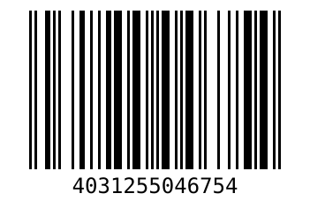 |
| Kiehl | Powerfix-Gel | `04031255000121` |  |
| Kiehl | Powerfix-Gel | `04031255045931` |  |
| Kiehl | Powerfix-Gel | `04031255045870` | 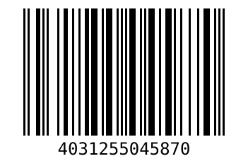 |
| Kiehl | Powerfix-Gel | `04031255045924` |  |
| Kiehl | Powerfix-Gel | `04031255035802` | 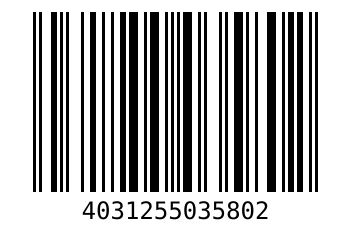 |
| Kiehl | Powerfix | `04031255032184` | 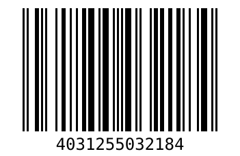 |
| Kiehl | Powerfix | `04031255036526` | 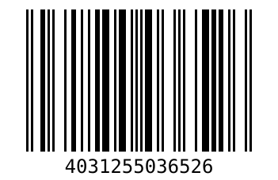 |
| Kiehl | Powerfix | `04031255002569` |  |
| Kiehl | Powerfix | `04031255012148` |  |
| Kiehl | Santex | `04031255003238` | 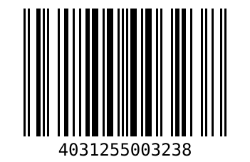 |
| Kiehl | Santex | `04031255003245` |  |
| Kiehl | Santex | `04031255032894` |  |
| Kiehl | Calinex | `04031255055367` | 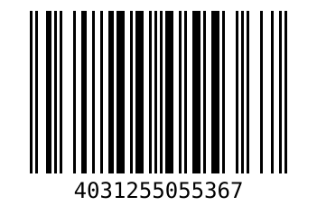 |
| Kiehl | Calinex | `04031255055817` |  |
| Kiehl | Calinex | `04031255055350` |  |
| Kiehl | Oxycal | `04031255042503` | 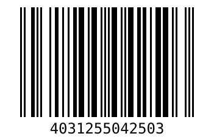 |
| Kiehl | Oxycal | `04031255042510` |  |
| Kiehl | Fumex | `04031255008349` | 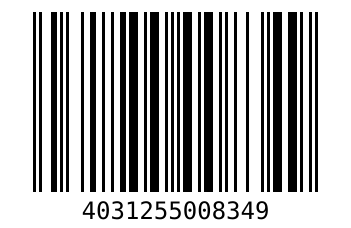 |
| Kiehl | Fumex | `04031255008325` |  |
| Kiehl | Fumex | `04031255008332` |  |
| Kiehl | Fumex | `04031255048888` | 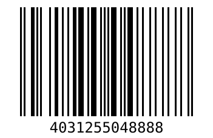 |
| Kiehl | Li-Ex | `04031255013107` |  |
| Kiehl | Li-Ex | `04031255032351` |  |
| Kiehl | Li-Ex | `04031255013114` |  |
| Kiehl | Li-Ex | `04031255035727` | 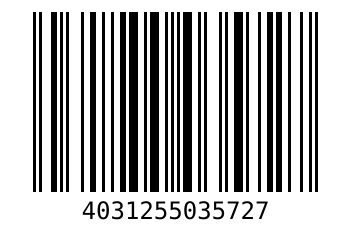 |
| Kiehl | Li-Ex | `04031255000435` |  |
| Kiehl | Li-Ex | `04031255002613` |  |
| Kiehl | Sanikal | `04031255000183` | 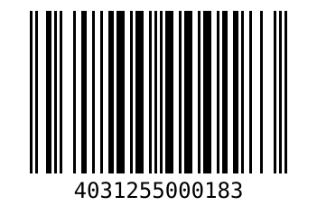 |
| Kiehl | Sanikal | `04031255000954` | 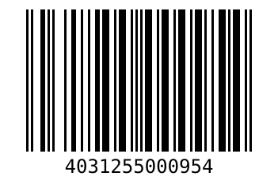 |
| Kiehl | Sanikal | `04031255000176` | 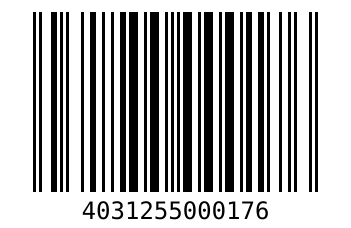 |
| Kiehl | Profloor-Konzentrat | `04031255001845` | 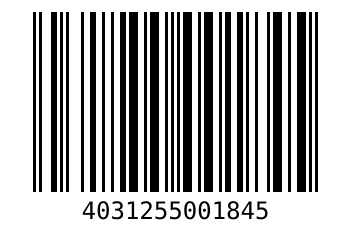 |
| Kiehl | Profloor-Konzentrat | `04031255003139` | 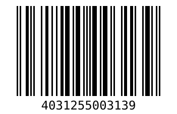 |
| Kiehl | Profloor-Konzentrat | `04031255003320` |  |
| Kiehl | Profloor-Konzentrat | `04031255003559` | 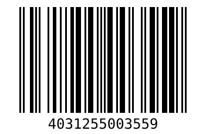 |
| Kiehl | Profloor-Konzentrat | `04031255001302` |  |
| Kiehl | Torvan-Konzentrat | `04031255000169` |  |
| Kiehl | Torvan-Konzentrat | `04031255057682` | 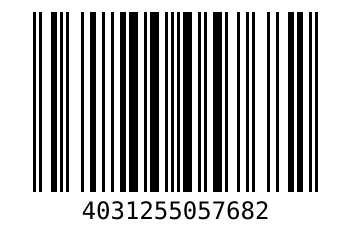 |
| Kiehl | Torvan-Konzentrat | `04031255013398` |  |
| Kiehl | Torvan-Konzentrat | `04031255015989` |  |
| Kiehl | Torvan-Konzentrat | `04031255013404` | 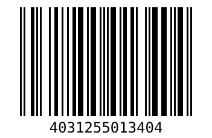 |
| Kiehl | Torvan-Konzentrat | `04031255000152` |  |
| Kiehl | Torvan-Konzentrat | `04031255057675` | 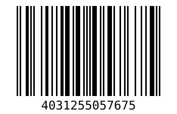 |
| Kiehl | Torvan-Konzentrat | `04031255003528` | 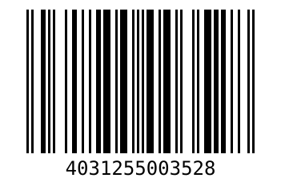 |
| Kiehl | Torvan-Konzentrat | `04031255000633` | 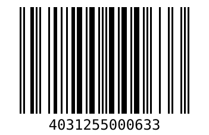 |
| Kiehl | Torvan-Konzentrat | `04031255018935` |  |
| Kiehl | Clean@oxy | `04031255057910` | 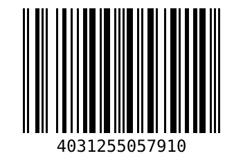 |
| Kiehl | Clean@oxy | `04031255057958` | 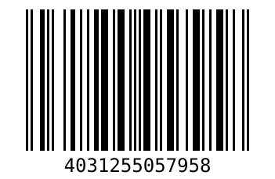 |
| Kiehl | Clean@oxy | `04031255058580` | 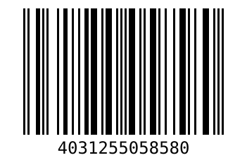 |
| DR.SCHNELL | MILIZID | `04008439001045` |  |
| DR.SCHNELL | MILIZID | `04008439300070` | 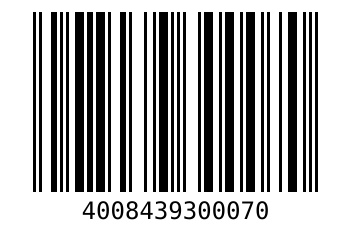 |
| DR.SCHNELL | MILIZID | `04008439300001` | 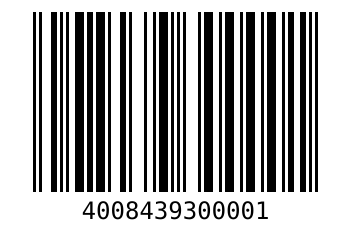 |
| DR.SCHNELL | MILIZID | `04008439001038` |  |
| CP GABA | Dan Klorix Hygienereiniger | `04011200652902` | 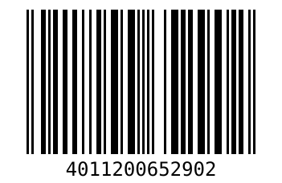 |
| Mellerud | Schimmel Vernichter | `04004666004675` | 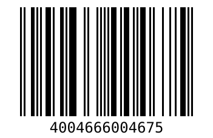 |
| DR.SCHNELL | ONEMÜ 2000 | `04008439001236` |  |
| DR.SCHNELL | EASY QUICK A | `04008439036863` | 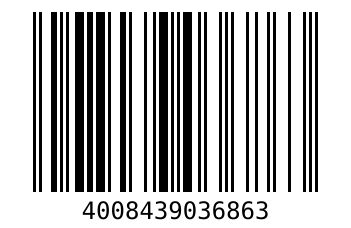 |
| DR.SCHNELL | EASY QUICK N | `04008439036283` | 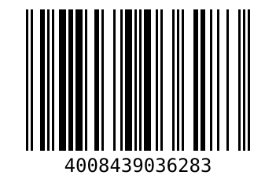 |
| DR.SCHNELL | GLASFEE | `04008439001564` | 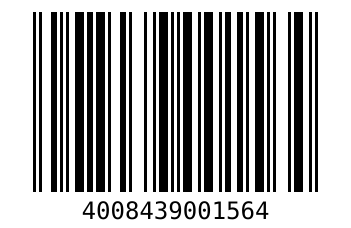 |
| DR.SCHNELL | GLASFEE | `04008439001373` | 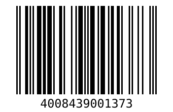 |
| DR.SCHNELL | GLASFEE | `04008439001427` | 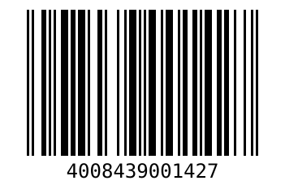 |
| DR.SCHNELL | MILIZID ECO | `04008439009928` | 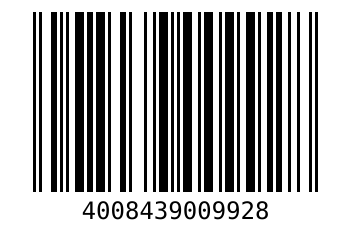 |
| DR.SCHNELL | MILIZID ECO | `04008439309974` |  |
| DR.SCHNELL | RAPIDO SPRÜH-EX | `04008439001953` |  |
| DR.SCHNELL | MILIZID KALKREINIGER | `04008439001069` | 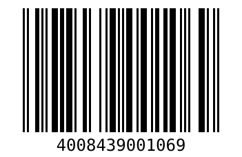 |
| DR.SCHNELL | MILIZID KALKREINIGER | `04008439300056` | 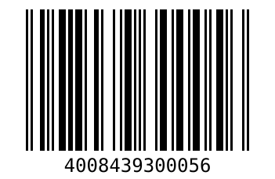 |
| DR.SCHNELL | ECOLUTION FOROL ULTRAHOCHKONZENTRAT | `04008439312127` | 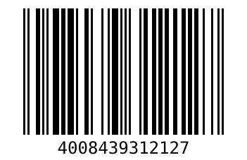 |
| DR.SCHNELL | LEVANTE ECO | `04008439035828` | 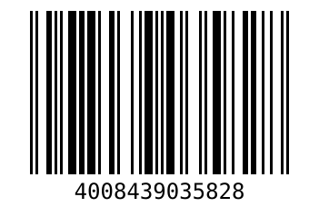 |
| DR.SCHNELL | SCHIROCCO CLEAN | `04008439007245` | 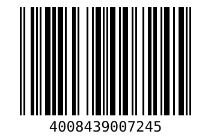 |
| DR.SCHNELL | SCHIROCCO CLEAN | `04008439307260` | 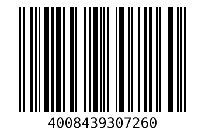 |
| DR.SCHNELL | SCHIROCCO CLEAN | `04008439307222` | 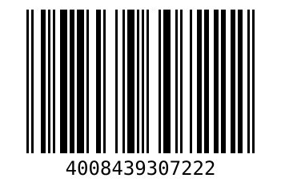 |
| DR.SCHNELL | EASY QUICK S | `04008439044103` |  |
| DR.SCHNELL | EASY QUICK S | `04008439044141` | 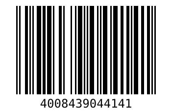 |
| DR.SCHNELL | DESIFOR-QUICK | `04008439205221` |  |
| DR.SCHNELL | DESIFOR-QUICK | `04008439204514` |  |
| DR.SCHNELL | DESIFOR-QUICK | `04008439045315` | 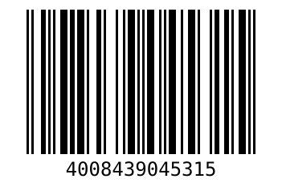 |
| DR.SCHNELL | ECOLUTION FOROL STICKS | `04008439312028` | 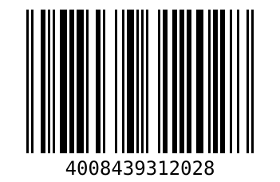 |
| DR.SCHNELL | GASTRO PUR | `04008439001472` |  |
| DR.SCHNELL | FOROL | `04008439001144` | 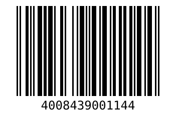 |
| DR.SCHNELL | FOROL | `04008439300179` |  |
| DR.SCHNELL | FOROL | `04008439300186` | 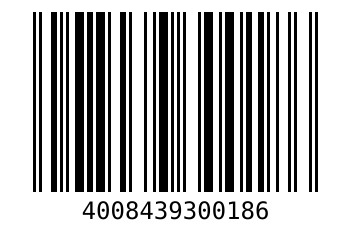 |
| DR.SCHNELL | FOROL | `04008439001113` | 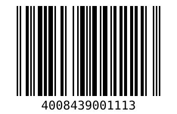 |
| DR.SCHNELL | DESIFOR-SD | `04008439204651` | 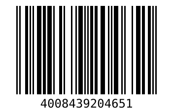 |
| DR.SCHNELL | DESIFOR-ONE | `04008439205580` |  |
| DR.SCHNELL | DESIFOR-PLEXIFEE | `04008439205931` | 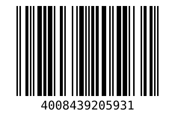 |
| DR.SCHNELL | DESIFOR-PLEXIFEE | `04008439205948` |  |
| DR.SCHNELL | FOROL SENSITIVE | `04008439009744` |  |
| DR.SCHNELL | DESIFOR-ONE V | `04008439204859` |  |
| DR.SCHNELL | PEROCID | `04008439006156` |  |
| DR.SCHNELL | PEROCID | `04008439363174` |  |
| DR.SCHNELL | PEROCID | `04008439360173` |  |
| DR.SCHNELL | PEROCID | `04008439360166` |  |
